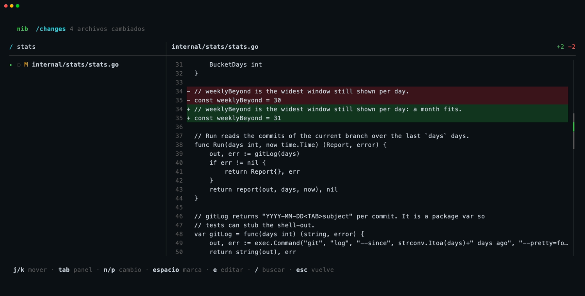
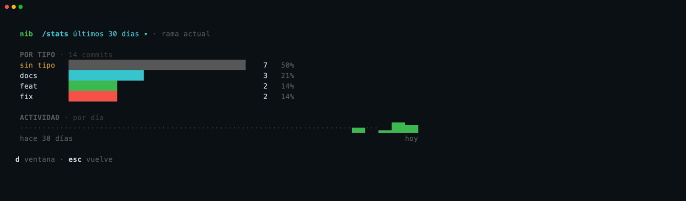
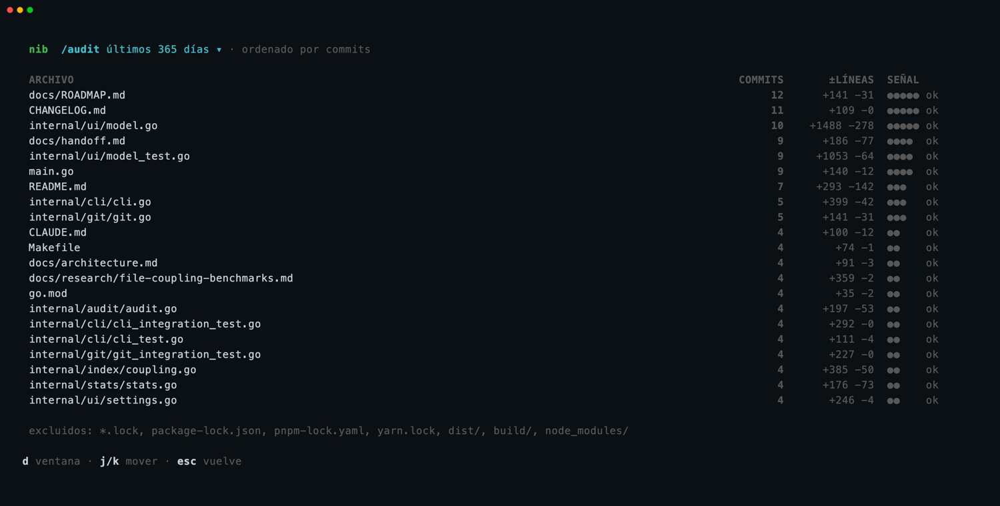

# nib

**English** · [Español](README.es.md)


A terminal tool to write [Conventional Commits](https://www.conventionalcommits.org/) in one line and **not forget anything**: while you mark files, nib tells you which other files usually change with them, according to the repository's git history.

Built to stay open in the VSCode terminal and commit on the fly.


---

## What you get

1. **One-line commits**: mark files → pick the type → type the message → `enter`. Mouse or keyboard.
2. **Related files**: what usually changes with the files you marked, and which of those are modified but not marked (the classic forgotten test).
3. **Analysis from the CLI**: `nib coupled <file>` explains what changes with a file, with percentages and the commits that back them.
4. **Inside the TUI, one `/` away**: review every diff and jump to your editor (`/changes`), see your commits by type (`/stats`), find the files that change the most (`/audit`), switch the heavy parts off (`/settings`).
5. **Measured, not promised**: `nib evaluate` checks on real commits whether the suggestions hit. Results below.

Everything is local: nib only reads your repository through `git` and keeps its index inside `.git/`.

---

## Install

Requires Go 1.26+ and git.

```bash
git clone https://github.com/nicovegasr/conventional-commit-tui
cd conventional-commit-tui
make build                     # builds ./nib
make install                   # installs nib into ~/go/bin (run it from any repo)
cp nib ~/.local/bin/           # or any folder on your PATH
```

Then, inside any repository:

```bash
nib
```

---

## The TUI — commit in one line

| Action | Keyboard | Mouse |
|---|---|---|
| Mark / unmark a file | `space` | click the file |
| Move through the list | `j` / `k` or arrows | — |
| Pick the type (`feat`, `fix`, …) | `tab` + its initial | click `[ feat ▾ ]` |
| Type the message and commit | type + `enter` | click the message |
| Go back / quit | `esc` · `q` · `ctrl+c` | — |

Below the commit line you see the exact subject that will be created (`→ feat: … .`), trailing period included. nib runs `git add` **only on the marked files**, never `git add .`.

The session stays open after committing: the file list and the git log reload every 2 s, so editor changes, `git add` or commits made from another terminal show up on their own. Your marks are kept.

### Related files

When you mark files, the right column shows the five that most often change with them:

- yellow `+`: **modified and not marked**. You are probably forgetting it.
- grey `·`: usually changes with the marked files, but you have not touched it.
- `↔` in the file list: the same hint, next to the file.

The percentage is the share of the marked file's commits that also touched the other one. The index is created on first use (a few seconds in the background on a large repository) and kept up to date after every commit, checkout or rebase. If anything fails, the panel collapses to one grey line and you can still commit.

Below 80 columns the right column hides, so it never gets in the way of the minimal flow.

---

## Commands inside the TUI — `/`

Type `/` on an empty message (or click `/ comandos`) to open the palette, type a few letters and press `enter`. `esc` takes you back to the commit view. You can run nib from any subdirectory of the repository.

### Review your changes — `/changes`



The changed files on the left, the whole selected file on the right with additions in green and deletions in red. Built to review what an agent or a long session changed without opening an IDE.

| Action | Keyboard | Mouse |
|---|---|---|
| Filter files by path | `/` and type | click the search box |
| Change file / scroll the diff | `j` / `k` (`tab` switches pane) | click · wheel |
| Next / previous change | `n` / `p` | the colored marks on the scrollbar |
| Jump half a page | `ctrl+d` / `ctrl+u` | drag the scrollbar |
| Mark the file for the commit | `space` | — |
| Edit the file at that change | `e` | — |

`e` hands the terminal to your editor, opened at the change you are looking at, and nib reloads the diff when you quit. The editor is `$VISUAL` or `$EDITOR` (e.g. `export EDITOR=vim` in your `.zshrc`), else `micro`, `nano` or `vi`. nib never edits files itself.

### Your commits by type — `/stats`



The current branch's commits by conventional type and their activity: per day up to 30 days, per week beyond. `d` or a click on the title cycles 7 · 30 · 90 · 365 days. Subjects without a `type:` prefix count as `sin tipo` — GitHub's default squash title (`Feat/audit (#13)`) is the usual culprit, so give your PRs a conventional title.

### Files that change the most — `/audit`



Files ranked by **how many commits touched them** (Adam Tornhill's hotspots); lines changed are context only. Files over the `/settings` threshold get `refactor?`, close to it `vigilar`. `d` cycles the window. Lockfiles and build output are skipped; add your own patterns to a `.auditignore` at the root, same format as `.nibignore`.

### Switch things off — `/settings`

The git-log panel, the related-files panel, mouse capture (off = native terminal selection and scroll), the log scope (current branch or all), the auto-reload interval and the `/audit` defaults. Changes apply live and are saved to `~/.config/nib/settings.toml`.

---

## What usually changes with this file? — `nib coupled`


```bash
nib index                                      # create or update the index
nib coupled internal/ui/model.go               # related files, with evidence
nib coupled internal/ui/model.go --json        # output for other tools
nib coupled internal/ui/model.go --before v1.0 # only history before a commit
```

Each row says how many commits both files shared (`6/7`) and cites concrete commits you can open with `git show`. By default every co-change counts, mass commits (more than 50 files) are ignored and recent history weighs more (90-day half-life).

To cut noise (lockfiles, changelogs, generated code), add a `.nibignore` at the root with one glob or directory per line. No reindexing needed:

```gitignore
*.lock
package-lock.json
CHANGELOG.md
dist/
```

---

## Does it actually work? — `nib evaluate`

`nib evaluate` hides past commits and asks nib, using **only the history before** each one, which other files changed. It compares against two baselines: plain co-change counting with no filters (`co-change`) and suggesting the repository's most-touched files (`frequency`).

Precision of the top 5 suggestions on each repository's most recent commits (parameters were tuned on older commits):

| Repository | nib | co-change | frequency |
|---|---:|---:|---:|
| fzf (Go) | **30.6%** | 23.9% | 18.0% |
| Django (Python) | **13.1%** | 11.5% | 2.3% |
| OkHttp (Kotlin/Java) | 20.0% | **21.9%** | 1.9% |
| Flask (Python) | 18.6% | **19.3%** | 2.8% |
| ripgrep (Rust) | 13.3% | 13.3% | 4.2% |
| Astro (TypeScript) | 7.9% | 7.9% | 1.7% |
| Personal blog (Astro) | 22.3% | **23.3%** | 11.6% |
| mean of 7 repositories | **18.0%** | 17.3% | 6.1% |

The honest reading: looking at **what changes with your file** hits about 3 times more often on average than looking at what changes most overall (from 1.7× on fzf to 10× on OkHttp). nib's filters add little over plain co-change on these small samples (24–52 cases per repository); on larger samples the advantage is about 2.5 points. Methodology and full numbers in [docs/research/file-coupling-benchmarks.md](docs/research/file-coupling-benchmarks.md).

```bash
nib evaluate --prefix src/ --ext .ts,.tsx     # measure nib on your own repository
```

---

## Limits

- A file is a **path**: renames do not join their history.
- Only history reachable from `HEAD`; shallow clones (`--depth`) are rejected.
- Historical co-change is not dependency nor a bug prediction: it is a hint.

---

## Documentation

| Document | Contents |
|---|---|
| [docs/architecture.md](docs/architecture.md) | Packages, flow and design rules |
| [docs/adr/](docs/adr/) | Decisions, one per file (index, evaluation, related-files panel…) |
| [docs/research/file-coupling-benchmarks.md](docs/research/file-coupling-benchmarks.md) | Benchmarks and evaluations on real repositories |
| [docs/ROADMAP.md](docs/ROADMAP.md) | What comes next |
| [docs/contributing.md](docs/contributing.md) | How to work on the repository |

---

## Development

```bash
make check   # format, vet, lint and tests (pre-commit)
make ci      # all of the above + ≥ 80% coverage + real git integration
make bench   # index microbenchmarks
```

The screenshots in this README are recorded with [vhs](https://github.com/charmbracelet/vhs) on a demo clone: `vhs assets/tapes/<name>.tape` (`tui`, `changes`, `stats`, `audit`, `coupled`).
